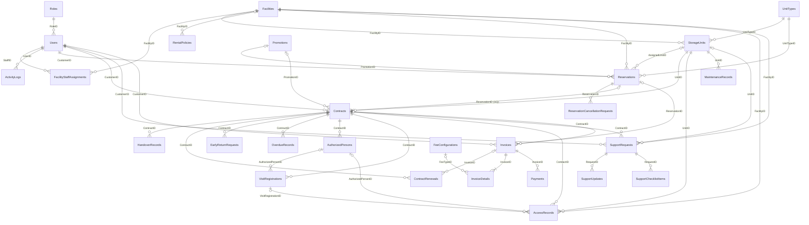

# Core Entity Relationship Diagram (ERD) — SelfStorageDB

Tài liệu này mô tả **Core Entity Relationship Diagram (Core ERD)** và **Full Database ERD (28 bảng)** của hệ thống **Self-Storage Management System (`SelfStorageDB`)**, được trích xuất trực tiếp từ schema thực tế ([01_schema.sql](file:///d:/self-storage/database/01_schema.sql) đến [19_single_active_session.sql](file:///d:/self-storage/database/19_single_active_session.sql)) và các lớp Entity trong [Data/Entities](file:///d:/self-storage/backend/SelfStorage.Api/Data/Entities).

- **Ảnh sơ đồ Core ERD chất lượng cao (PNG, dùng để chèn vào SRD / SDS / Báo cáo):** [Core_ERD_SelfStorageDB.png](file:///d:/self-storage/docs/Core_ERD_SelfStorageDB.png)

---

## 1. Core Entity Relationship Diagram (12 Bảng Cốt Lõi)

Sơ đồ dưới đây tập trung vào **12 bảng cốt lõi** đại diện cho 5 phân hệ nghiệp vụ chính của hệ thống:
1. **Identity & Access Scope:** `Roles`, `Users`
2. **Facility & Inventory:** `Facilities`, `UnitTypes`, `StorageUnits`
3. **Reservation & Rental Contract:** `Reservations`, `Contracts`
4. **Billing & Payment:** `Invoices`, `InvoiceDetails`, `Payments`
5. **Gate Access & Customer Support:** `AuthorizedPersons`, `AccessRecords`, `SupportRequests`

```mermaid
erDiagram
    Roles ||--o{ Users : "1 Role -> N Users (RoleID)"
    
    Facilities ||--o{ StorageUnits : "1 Facility -> N Units (FacilityID)"
    UnitTypes ||--o{ StorageUnits : "1 UnitType -> N Units (UnitTypeID)"
    
    Users ||--o{ Reservations : "Customer đặt chỗ (CustomerID)"
    Facilities ||--o{ Reservations : "Tại cơ sở (FacilityID)"
    UnitTypes ||--o{ Reservations : "Loại ô kho (UnitTypeID)"
    StorageUnits |o--o{ Reservations : "Gán ô kho (AssignedUnitID)"
    
    Reservations |o--o| Contracts : "Chuyển thành HĐ 0..1 (ReservationID UQ)"
    Users ||--o{ Contracts : "Khách thuê (CustomerID)"
    Users ||--o{ Contracts : "Staff lập HĐ (StaffCreatedID)"
    StorageUnits ||--o{ Contracts : "Ô kho cho thuê (UnitID)"
    
    Reservations |o--o{ Invoices : "Hóa đơn cọc (ReservationID)"
    Contracts |o--o{ Invoices : "Hóa đơn thuê/phí (ContractID)"
    Users ||--o{ Invoices : "Khách thanh toán (CustomerID)"
    Invoices ||--|{ InvoiceDetails : "Chi tiết dòng phí (InvoiceID)"
    Invoices ||--o{ Payments : "Giao dịch thanh toán (InvoiceID)"
    
    Contracts ||--o{ AuthorizedPersons : "Người được ủy quyền (ContractID)"
    Contracts ||--o{ AccessRecords : "Nhật ký ra/vào cổng (ContractID)"
    StorageUnits ||--o{ AccessRecords : "Truy cập ô kho (UnitID)"
    AuthorizedPersons |o--o{ AccessRecords : "Người ủy quyền vào kho (AuthorizedPersonID)"
    
    Users ||--o{ SupportRequests : "Khách gửi yêu cầu (CustomerID)"
    Contracts |o--o{ SupportRequests : "Theo hợp đồng (ContractID)"
    StorageUnits |o--o{ SupportRequests : "Theo ô kho (UnitID)"

    Roles {
        int RoleID PK
        nvarchar RoleName UQ "SystemAdmin, Manager, Staff, Customer"
        nvarchar Description
    }

    Users {
        int UserID PK
        int RoleID FK
        nvarchar Username UQ
        nvarchar Email UQ
        nvarchar FullName
        nvarchar PhoneNumber
        nvarchar CitizenID UQ
        nvarchar GoogleSubject
        nvarchar ActiveSessionId "Single-Session JWT Validation"
        datetime2 SessionIssuedAt
        nvarchar Status "Active, Locked, Inactive"
    }

    Facilities {
        int FacilityID PK
        nvarchar FacilityName
        nvarchar Address
        nvarchar City
        nvarchar District
        nvarchar ContactPhone
        nvarchar OperatingHours
        nvarchar Status "Active, Maintenance, Closed"
    }

    UnitTypes {
        int UnitTypeID PK
        nvarchar TypeName
        decimal LengthMeters
        decimal WidthMeters
        decimal HeightMeters
        decimal VolumeCubicMeters "Computed (L*W*H)"
        bit HasClimateControl
        decimal BaseDailyRate
        decimal BaseMonthlyRate
    }

    StorageUnits {
        int UnitID PK
        int FacilityID FK
        int UnitTypeID FK
        nvarchar UnitCode "UQ (FacilityID, UnitCode)"
        int FloorNumber
        decimal MonthlyPrice
        nvarchar Status "Available, Reserved, Occupied, Maintenance, LockedOverdue"
    }

    Reservations {
        int ReservationID PK
        nvarchar ReservationCode UQ
        int CustomerID FK
        int FacilityID FK
        int UnitTypeID FK
        int AssignedUnitID FK "Nullable"
        int PromotionID FK "Nullable"
        date ExpectedStartDate
        datetime2 CheckInAppointmentAt "Nullable"
        int DurationMonths
        decimal DepositAmount
        decimal EstimatedTotalFee
        datetime2 DepositDeadline
        nvarchar Status "PendingDeposit, Confirmed, CheckedIn, Expired, Cancelled"
    }

    Contracts {
        int ContractID PK
        nvarchar ContractNumber UQ
        int ReservationID FK "Nullable, UQ"
        int CustomerID FK
        int UnitID FK
        int StaffCreatedID FK
        int PromotionID FK "Nullable"
        date StartDate
        date EndDate
        decimal MonthlyRentFee
        decimal DepositPaid
        decimal DiscountApplied
        nvarchar Status "Draft, Active, OverdueLocked, Expired, Terminated, Completed"
    }

    Invoices {
        int InvoiceID PK
        nvarchar InvoiceNumber UQ
        int ContractID FK "Nullable"
        int ReservationID FK "Nullable"
        int CustomerID FK
        nvarchar InvoiceType "Deposit, InitialRent, MonthlyRent, Renewal, Penalty, EarlyReturn"
        decimal SubTotal
        decimal DiscountAmount
        decimal TotalAmount "Computed (SubTotal - DiscountAmount)"
        date DueDate
        date BillingPeriodStart "Nullable"
        date BillingPeriodEnd "Nullable"
        nvarchar Status "Unpaid, Paid, Overdue, Cancelled, Refunded"
    }

    InvoiceDetails {
        int DetailID PK
        int InvoiceID FK
        int FeeTypeID FK "Nullable"
        nvarchar Description
        int Quantity
        decimal UnitPrice
        decimal LineTotal "Computed (Quantity * UnitPrice)"
    }

    Payments {
        int PaymentID PK
        int InvoiceID FK
        int ReceivedByStaffID FK "Nullable"
        nvarchar PaymentMethod "VNPay, BankTransfer, Cash, Card, Momo"
        nvarchar TransactionCode
        decimal AmountPaid
        datetime2 PaymentDate
        nvarchar Status "Pending, Success, Failed, Refunded"
    }

    AuthorizedPersons {
        int AuthorizedPersonID PK
        int ContractID FK
        nvarchar FullName
        nvarchar PhoneNumber
        nvarchar CitizenID "UQ (ContractID, CitizenID)"
        nvarchar Relationship
        nvarchar Status "Active, Revoked"
    }

    AccessRecords {
        bigint AccessRecordID PK
        int ContractID FK
        int VisitRegistrationID FK "Nullable"
        int FacilityID FK
        int UnitID FK
        int AuthorizedPersonID FK "Nullable"
        int VerifiedByStaffID FK
        int ExitConfirmedByStaffID FK "Nullable"
        nvarchar Result "Granted, Denied"
        nvarchar DenyReason "Nullable"
        datetime2 EntryTime
        datetime2 ExitTime "Nullable"
    }

    SupportRequests {
        int RequestID PK
        nvarchar RequestCode UQ
        int CustomerID FK
        int FacilityID FK
        int ContractID FK "Nullable"
        int UnitID FK "Nullable"
        int AssignedStaffID FK "Nullable"
        nvarchar Category "AccessIssue, Maintenance, Billing, EarlyReturn, Other"
        nvarchar Priority "Low, Medium, High, Urgent"
        nvarchar Subject
        nvarchar Status "Open, InProgress, Resolved, Closed"
    }
```

---

## 2. Full Database ERD (Toàn Bộ 28 Bảng Của `SelfStorageDB`)

Sơ đồ dưới đây bao quát đầy đủ **28 bảng** trong cơ sở dữ liệu (bao gồm các bảng cấu hình chính sách, bàn giao, gia hạn, trả kho sớm, quá hạn, đăng ký lịch ra vào, bảo trì, checklist hỗ trợ và hàng đợi email):



---

## 3. Bảng Tổng Hợp Quan Hệ Khóa Ngoại (Foreign Key & Cardinality Matrix)

| STT | Phân hệ | Bảng Nguồn (Child) | Khóa Ngoại (FK) | Bảng Đích (Parent) | Quan Hệ (Cardinality) | Ý Nghĩa Nghiệp Vụ |
| :-: | :--- | :--- | :--- | :--- | :---: | :--- |
| 1 | **Identity** | `Users` | `RoleID` | `Roles` | `N : 1` | Mỗi người dùng thuộc 1 vai trò (`SystemAdmin`, `Manager`, `Staff`, `Customer`). |
| 2 | **Identity** | `FacilityStaffAssignments` | `FacilityID`, `StaffID` | `Facilities`, `Users` | `N : 1` | Phân công nhân viên (`Staff`) phụ trách theo từng cơ sở kho (`UQ (FacilityID, StaffID)`). |
| 3 | **Identity** | `ActivityLogs` | `UserID` | `Users` | `N : 1` | Lưu vết nhật ký thao tác hệ thống của người dùng. |
| 4 | **Inventory** | `StorageUnits` | `FacilityID` | `Facilities` | `N : 1` | Mỗi ô kho thuộc về 1 cơ sở kho xác định (`UQ (FacilityID, UnitCode)`). |
| 5 | **Inventory** | `StorageUnits` | `UnitTypeID` | `UnitTypes` | `N : 1` | Mỗi ô kho có 1 loại kích thước, thể tích (`L*W*H`) và cấu hình điều hòa. |
| 6 | **Policy** | `RentalPolicies` | `FacilityID` (NULL) | `Facilities` | `0..N : 1` | Chính sách đặt cọc, ân hạn hủy, phạt quá hạn áp dụng toàn hệ thống (`NULL`) hoặc riêng từng cơ sở. |
| 7 | **Booking** | `Reservations` | `CustomerID` | `Users` | `N : 1` | Khách hàng tạo đơn đặt chỗ trực tuyến. |
| 8 | **Booking** | `Reservations` | `FacilityID`, `UnitTypeID` | `Facilities`, `UnitTypes` | `N : 1` | Đặt chỗ theo cơ sở và loại ô kho mong muốn. |
| 9 | **Booking** | `Reservations` | `AssignedUnitID` (NULL) | `StorageUnits` | `0..N : 1` | Ô kho cụ thể được giữ chỗ hoặc được Staff chỉ định khi check-in. |
| 10 | **Booking** | `Reservations` | `PromotionID` (NULL) | `Promotions` | `0..N : 1` | Mã khuyến mãi áp dụng cho đơn đặt chỗ. |
| 11 | **Booking** | `ReservationCancellationRequests` | `ReservationID` | `Reservations` | `N : 1` | Yêu cầu hủy đặt chỗ & hoàn tiền cọc của khách hàng. |
| 12 | **Contract** | `Contracts` | `ReservationID` (NULL, UQ) | `Reservations` | `0..1 : 1` | Mỗi đơn đặt chỗ (`Confirmed`/`CheckedIn`) chuyển đổi thành tối đa 1 hợp đồng thuê chính thức. |
| 13 | **Contract** | `Contracts` | `CustomerID`, `StaffCreatedID` | `Users` | `N : 1` | Liên kết khách hàng đứng tên thuê và nhân viên tạo hợp đồng. |
| 14 | **Contract** | `Contracts` | `UnitID` | `StorageUnits` | `N : 1` | Ô kho được thuê theo hợp đồng (trạng thái chuyển sang `Occupied`). |
| 15 | **Contract** | `HandoverRecords` | `ContractID`, `StaffID` | `Contracts`, `Users` | `N : 1` | Biên bản bàn giao nhận kho (`CheckIn`) và trả kho (`CheckOut`). |
| 16 | **Contract** | `ContractRenewals` | `ContractID`, `InvoiceID` (NULL) | `Contracts`, `Invoices` | `N : 1` | Lịch sử gia hạn hợp đồng (`1..12` tháng/lần) gắn với hóa đơn phí gia hạn. |
| 17 | **Contract** | `EarlyReturnRequests` | `ContractID`, `CustomerID` | `Contracts`, `Users` | `N : 1` | Yêu cầu trả kho trước hạn và xác nhận thu hồi ô kho. |
| 18 | **Contract** | `OverdueRecords` | `ContractID` | `Contracts` | `N : 1` | Hồ sơ theo dõi nợ quá hạn, tính phí phạt và khóa ô kho (`OverdueLocked`). |
| 19 | **Access** | `AuthorizedPersons` | `ContractID` | `Contracts` | `N : 1` | Danh sách người được chủ hợp đồng ủy quyền ra/vào ô kho (`UQ (ContractID, CitizenID)`). |
| 20 | **Access** | `VisitRegistrations` | `ContractID`, `AuthorizedPersonID` | `Contracts`, `AuthorizedPersons` | `N : 1` | Đăng ký lịch hẹn ra/vào kho trước của khách hoặc người được ủy quyền. |
| 21 | **Access** | `AccessRecords` | `ContractID`, `UnitID`, `FacilityID` | `Contracts`, `StorageUnits`, `Facilities` | `N : 1` | Nhật ký kiểm soát cổng ra/vào thực tế (`Granted`/`Denied`, `EntryTime`, `ExitTime`). |
| 22 | **Billing** | `Invoices` | `ContractID` (NULL), `ReservationID` (NULL) | `Contracts`, `Reservations` | `0..N : 1` | Hóa đơn phát sinh từ Đặt chỗ (`Deposit`) hoặc Hợp đồng (`InitialRent`, `MonthlyRent`, `Renewal`, `Penalty`). |
| 23 | **Billing** | `InvoiceDetails` | `InvoiceID`, `FeeTypeID` (NULL) | `Invoices`, `FeeConfigurations` | `N : 1` | Các dòng chi tiết phí cấu thành nên tổng tiền hóa đơn (`LineTotal = Quantity * UnitPrice`). |
| 24 | **Billing** | `Payments` | `InvoiceID` | `Invoices` | `N : 1` | Giao dịch thanh toán (`VNPay`, `Cash`, `BankTransfer`...) cho hóa đơn. |
| 25 | **Support** | `MaintenanceRecords` | `UnitID`, `AssignedStaffID` | `StorageUnits`, `Users` | `N : 1` | Lịch sử bảo trì, vệ sinh, sửa chữa định kỳ hoặc đột xuất trên từng ô kho. |
| 26 | **Support** | `SupportRequests` | `CustomerID`, `FacilityID`, `ContractID`, `UnitID` | `Users`, `Facilities`, `Contracts`, `StorageUnits` | `N : 1` | Ticket yêu cầu hỗ trợ của khách hàng gắn với cơ sở, hợp đồng và ô kho. |
| 27 | **Support** | `SupportUpdates`, `SupportChecklistItems` | `RequestID` | `SupportRequests` | `N : 1` | Lịch sử phản hồi xử lý và danh mục công việc (checklist) của từng ticket hỗ trợ. |

